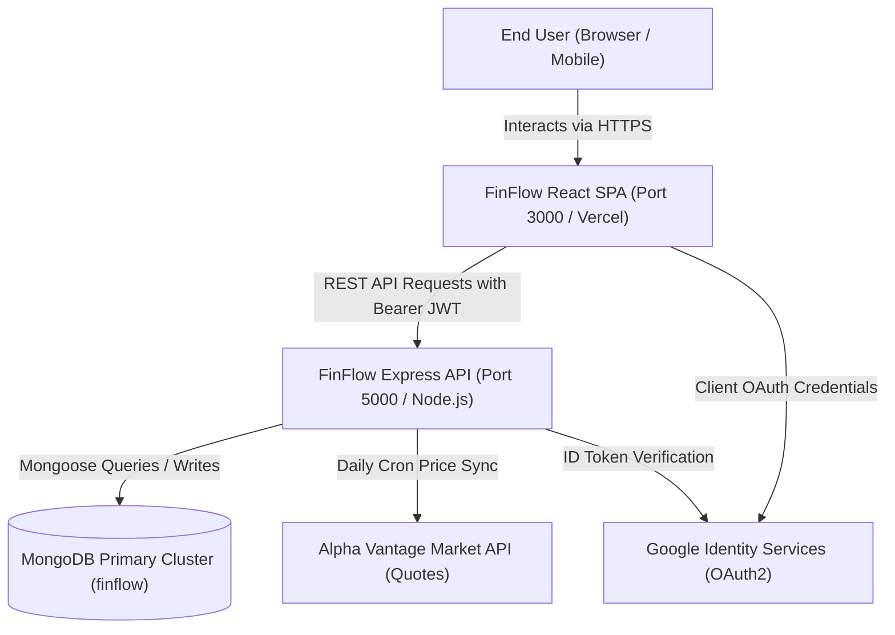
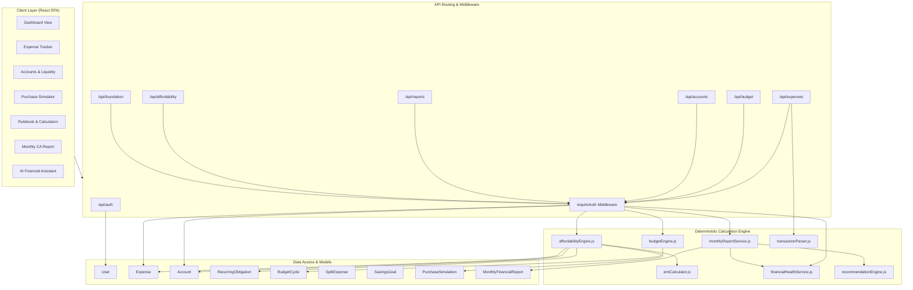
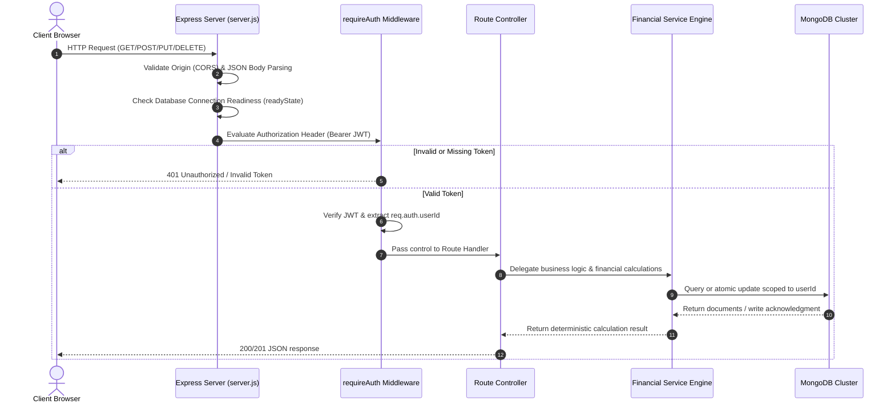
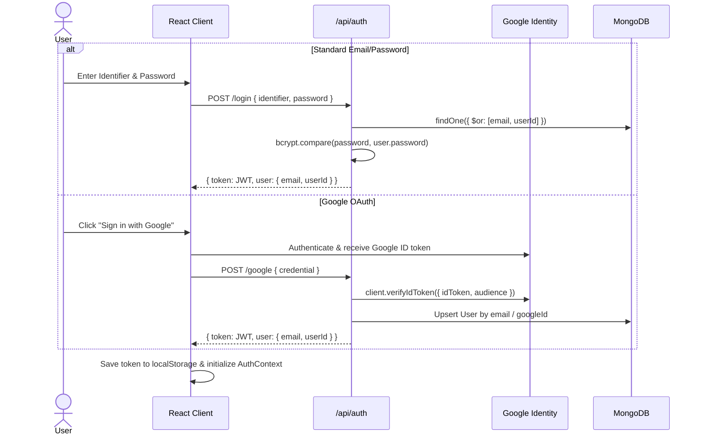
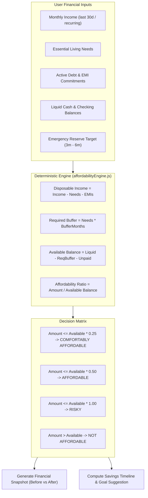

# FinFlow — System Architecture & Technical Specification

## 1. Project Overview & System Context

**FinFlow** is an institutional-grade Personal Financial Operating System designed to help individuals audit transactions, manage multi-account liquidity, enforce budget cycles, track investment portfolios, generate monthly CA audit reports, and simulate major purchases using deterministic mathematical modeling.



---

## 2. Technology Stack

### 2.1 Frontend Tier
- **Framework:** React 19.2.4 (Single Page Application initialized via `create-react-app`)
- **Routing:** State-based active tab routing via centralized `page` state in `App.jsx`
- **Component Styling:** Custom theme token architecture (`shared.jsx` + `style.css`), supporting dual-mode Dark (`#1E1E1C` Charcoal) and Light (`#F3EEE3` Cream) themes
- **Visualization:** Recharts 3.8.1 (Area, Bar, and Pie charts for wealth projection and spending analytics)
- **Icons:** Lucide React 1.28.0
- **HTTP Client:** Axios 1.14.0 with request interceptors injecting JWT Bearer tokens
- **Authentication:** Custom JWT stored in `localStorage` + `@react-oauth/google` for OAuth authentication

### 2.2 Backend Tier
- **Runtime:** Node.js v20+ with native test runner (`node --test`)
- **Server Framework:** Express 5.2.1
- **Database Driver:** Mongoose 9.3.3
- **Security & Crypto:** `bcryptjs` (password hashing with cost factor 10), `jsonwebtoken` (HMAC SHA-256 tokens)
- **Scheduling:** `node-cron` 4.2.1 (daily stock quotes sync and monthly CA report generation)
- **Document Generation:** Custom PDF generator (PDF-1.4 spec buffer builder) and RFC 4180 compliant CSV generator

### 2.3 Database Tier
- **Engine:** MongoDB (Document Store)
- **Database Name:** `finflow`
- **Precision Architecture:** Hybrid representation:
  - Account balances, debts, obligations, savings goals: `Schema.Types.Decimal128`
  - Historical expenses, stock holdings, mutual fund units: `Number` (IEEE 754)

---

## 3. System Architecture Diagram



---

## 4. Frontend Architecture

### 4.1 Component Tree & Page Orchestration
- **Application Shell (`App.jsx`):** Maintains master navigation state (`page`), dual-theme state (`theme`), currency preferences (`currency`), and global modal visibility (AuthModal, QuickPasteModal, OnboardingModal, Chatbot).
- **Page Views (`src/pages/`):**
  - `Dashboard.jsx`: Executive overview, safe-to-spend card, recent transactions, portfolio summary, who-owes-me, and upcoming obligations.
  - `ExpenseTracker.jsx`: Categorized transaction ledger, category filter pills, need vs. want breakdown, manual and CSV export actions.
  - `PurchaseSimulator.jsx`: Purchase affordability calculator, EMI comparison, post-purchase balance impact, and goal creation.
  - `MonthlyCAReport.jsx`: Monthly financial statement, health score breakdown, category shifts, provisional vs. finalized status, PDF and CSV exports.
  - `FinancialMilestones.jsx`: Foundation score ring (0-100), self-reported emergency reserve and health insurance tracking.
  - `FinancialRulebook.jsx`: 28 categorized personal finance rules and interactive formula calculators.
  - `Portfolio.jsx`: Asset class management (Stocks, Mutual Funds, Fixed Deposits).
  - `InvestmentPlanner.jsx`: Step-by-step monthly income allocation across diverse asset classes.
  - `WealthProjection.jsx`: Compound interest SIP trajectory projection chart.
  - `UserProfile.jsx`: User identity settings and password updates.

### 4.2 State Management & Network Layer
- Authentication state is encapsulated within `AuthContext.jsx` and persisted across browser sessions via `localStorage.getItem("token")`.
- Global HTTP calls are routed through an Axios singleton (`src/api.js`) configured with request interceptors that attach `Authorization: Bearer <token>`.
- The application utilizes localized component state (`useState`, `useCallback`, `useMemo`) rather than heavy global state libraries (Redux/Zustand), optimizing bundle footprint.

---

## 5. Backend Architecture & Service Responsibilities

### 5.1 Request Lifecycle & Middleware Flow



### 5.2 Service Domain Responsibilities

| Service Module | File Path | Core Domain Responsibility |
| :--- | :--- | :--- |
| **Affordability Engine** | `backend/services/affordabilityEngine.js` | Computes disposable income, required emergency buffers, full payment affordability, EMI eligibility, and savings roadmaps without writing transactions. |
| **Budget Engine** | `backend/services/budgetEngine.js` | Calculates custom budget cycle windows (1st-to-last or mid-month e.g., 25th-to-24th), aggregates cycle spend, and computes daily Safe-to-Spend. |
| **EMI Calculator** | `backend/services/emiCalculator.js` | Deterministic reducing-balance loan arithmetic: $E = P \cdot r \cdot \frac{(1+r)^n}{(1+r)^n - 1}$ and Zero-Interest no-cost EMI scheduling. |
| **Monthly CA Report Service** | `backend/services/monthlyReportService.js` | Aggregates income, expenses, investments, debts, and category changes across calendar months. Manages provisional vs. finalized report snapshots. |
| **Financial Health Engine** | `backend/services/financialHealthService.js` | 100-point deterministic scoring algorithm across 6 pillars (savings, budget discipline, emergency buffer, debt, investing, cash flow). |
| **Foundation Service** | `backend/services/foundationService.js` | Manages milestone status (emergency fund + health insurance), computes 0-100 Foundation Score, and onboarding status. |
| **Transaction SMS Parser** | `backend/utils/transactionParser.js` | Regex pattern matching for Indian banking SMS (HDFC, SBI, ICICI, Axis, UPI debit/credit notifications) with learned merchant mapping. |

---

## 6. Authentication & Authorization Flow



- **Authorization Model:** Single-tenant resource isolation. Every database query strictly includes `{ userId: req.auth.userId }` to prevent horizontal privilege escalation or cross-user data exposure.

---

## 7. Financial Calculation Architecture



---

## 8. Scheduled Background Tasks (`backend/cron/schedular.js`)

FinFlow incorporates two background cron jobs:
1. **Daily Stock Quote Sync (`35 15 * * *` Asia/Kolkata):**
   - Fires at 3:35 PM IST on market trading days.
   - Gathers all distinct stock tickers across user portfolios and queries the Alpha Vantage `GLOBAL_QUOTE` endpoint.
   - Throttles requests by 1000ms per ticker to respect external API rate limits.
   - Updates `Stock.cmp` (current market price) in the database.
2. **Automated Monthly Personal CA Report (`0 2 1 * *` Asia/Kolkata):**
   - Fires at 2:00 AM IST on the 1st day of every month.
   - Iterates through all registered users.
   - Freezes and finalizes the previous month's `MonthlyFinancialReport` snapshot (`isProvisional: false`).

---

## 9. Deployment Topology & Environments

```mermaid
graph LR
    subgraph CDN ["Edge / Hosting (Vercel)"]
        StaticAssets["React Production Build (HTML/JS/CSS)"]
    end

    subgraph Compute ["Compute (Node.js Environment / Render / VPS)"]
        ExpressApp["Express Server (PORT 5000)"]
        CronRunner["In-process node-cron Worker"]
    end

    subgraph Data ["Data Layer (MongoDB Atlas)"]
        MongoCluster[("MongoDB Replica Set (TLS / SCRAM-SHA-256)")]
    end

    StaticAssets -->|HTTPS REST API| ExpressApp
    ExpressApp -->|Mongoose Connection Pool (5s timeout)| MongoCluster
    CronRunner -->|Batch Updates| MongoCluster
```

---

## 10. Architectural Limitations & Current Technical Debt

1. **Monolithic In-Process Scheduler:** The cron scheduler runs inside the single Node.js Express process. In a multi-instance horizontally scaled deployment, cron jobs will execute redundantly unless locked via a distributed coordinator or external scheduler.
2. **Hybrid Numeric Precision:** Certain collections (`Expense`, `Income`) utilize standard JavaScript floats, while accounts utilize `Decimal128`. Financial accumulation over long timelines must be normalized to Decimal128 across all transaction tables.
3. **No Database Transactions for Account Debits:** Expense creation and account balance decrement occur in sequence without a formal MongoDB multi-document session transaction.
