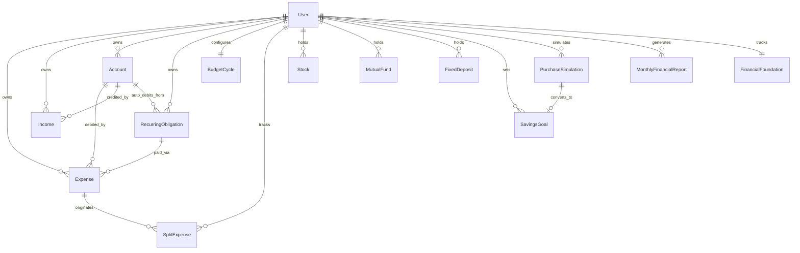

# FinFlow — Database Architecture & Schema Specification

## 1. Overview
FinFlow uses **MongoDB** as its primary persistent store. This document formalizes all 15 declared Mongoose schemas, indexes, relationships, monetary precision patterns, and potential database risks.

---

## 2. Entity Relationship Diagram (ERD)

---

## 3. Comprehensive Collection Catalog

### 3.1 `User`
- **Collection:** `users`
- **Fields:**
  - `userId`: `String` (Required, Unique, Index). Primary user identifier.
  - `email`: `String` (Required, Unique). User email address.
  - `password`: `String` (Optional for OAuth users). Bcrypt hashed password.
  - `googleId`: `String` (Optional). Google OAuth subject identifier.
- **Timestamps:** `{ createdAt, updatedAt }`

### 3.2 `Expense` (Aliased as `Transaction`)
- **Collection:** `expenses`
- **Fields:**
  - `userId`: `String` (Required, Index).
  - `date`: `Date` (Required). Transaction timestamp.
  - `category`: `String` (Required, Enum: `["Food","Travel","Utilities","Shopping","Health","Dining","Rent","Education","OTT","Savings","Other"]`).
  - `label`: `String` (Required, Trimmed). Payee or merchant name.
  - `amount`: `Number` (Required, Min: 0).
  - `type`: `String` (Required, Enum: `["need", "want"]`).
  - `notes`: `String` (Default: `""`).
  - `obligationId`: `ObjectId` (Ref: `RecurringObligation`, Optional).
  - `accountId`: `ObjectId` (Ref: `Account`, Optional). Account debited.
  - `splitExpenseId`: `ObjectId` (Ref: `SplitExpense`, Optional).
  - `source`: `String` (Enum: `["MANUAL", "SMS_PASTE", "IMPORT"]`, Default: `"MANUAL"`).
  - `externalReference`: `String` (Optional, Trimmed). UTR / Bank reference.
  - `merchant`: `String` (Optional, Trimmed).
  - `paymentMethod`: `String` (Optional, Trimmed).
- **Indexes:**
  - `{ userId: 1, date: -1 }` (Primary ledger chronological scan)
  - `{ userId: 1, accountId: 1 }`
  - `{ userId: 1, obligationId: 1 }`
  - `{ userId: 1, externalReference: 1 }`
  - `{ userId: 1, splitExpenseId: 1 }`

### 3.3 `Account`
- **Collection:** `accounts`
- **Fields:**
  - `userId`: `String` (Required, Index).
  - `name`: `String` (Required, Trimmed).
  - `type`: `String` (Required, Enum: `["CHECKING", "SAVINGS", "WALLET", "CASH"]`).
  - `currentBalance`: `Decimal128` (Required, Default: `0.00`).
  - `currency`: `String` (Default: `"INR"`).
  - `isLiquid`: `Boolean` (Default: `true`).
  - `isActive`: `Boolean` (Default: `true`).
- **Indexes:**
  - `{ userId: 1, name: 1 }` (Unique constraint: unique account name per user)
  - `{ userId: 1, isActive: 1 }`

### 3.4 `RecurringObligation`
- **Collection:** `recurringobligations`
- **Fields:**
  - `userId`: `String` (Required, Index).
  - `accountId`: `ObjectId` (Ref: `Account`, Optional).
  - `title`: `String` (Required, Trimmed).
  - `amount`: `Decimal128` (Required).
  - `dueDay`: `Number` (Required, Min: 1, Max: 31).
  - `category`: `String` (Required, Default: `"Utilities"`).
  - `frequency`: `String` (Enum: `["MONTHLY", "WEEKLY", "YEARLY"]`, Default: `"MONTHLY"`).
  - `isActive`: `Boolean` (Default: `true`).
  - `nextDueDate`: `Date` (Optional).
  - `lastPaidDate`: `Date` (Optional).
  - `lastPaidTransactionId`: `ObjectId` (Ref: `Expense`, Optional).
- **Indexes:**
  - `{ userId: 1, isActive: 1 }`
  - `{ userId: 1, nextDueDate: 1 }`

### 3.5 `BudgetCycle`
- **Collection:** `budgetcycles`
- **Fields:**
  - `userId`: `String` (Required, Unique, Index). Single document per user.
  - `cycleStartDay`: `Number` (Default: `1`, Min: 1, Max: 31).
  - `monthlySavingsGoal`: `Decimal128` (Default: `0.00`).
  - `minSafetyBuffer`: `Decimal128` (Default: `0.00`).
  - `currency`: `String` (Default: `"INR"`).

### 3.6 `SplitExpense` (Peer Debt)
- **Collection:** `splitexpenses`
- **Fields:**
  - `userId`: `String` (Required, Index).
  - `originalTransactionId`: `ObjectId` (Ref: `Expense`, Optional).
  - `borrowerName`: `String` (Required, Trimmed).
  - `amount`: `Decimal128` (Required).
  - `settledAmount`: `Decimal128` (Default: `0.00`).
  - `status`: `String` (Enum: `["PENDING", "PARTIAL", "SETTLED"]`, Default: `"PENDING"`).
  - `dueDate`: `Date` (Optional).
  - `notes`: `String` (Default: `""`).
  - `settlements`: Array of `{ amount: Decimal128, settledAt: Date, accountId: ObjectId, notes: String }`.
- **Indexes:**
  - `{ userId: 1, status: 1 }`
  - `{ userId: 1, borrowerName: 1 }`

### 3.7 `PurchaseSimulation`
- **Collection:** `purchasesimulations`
- **Fields:**
  - `userId`: `String` (Required, Index).
  - `productName`: `String` (Required, Trimmed).
  - `amount`: `Number` (Required, Min: 0).
  - `category`: `String` (Default: `"General"`).
  - `priority`: `String` (Enum: `["Essential", "Important", "Optional", "Luxury"]`).
  - `paymentMethod`: `String` (Enum: `["FULL_PAYMENT", "EMI", "UPFRONT", "CREDIT_CARD"]`).
  - Financial baselines: `monthlyIncome`, `essentialExpenses`, `existingEMIs`, `plannedSavings`, `liquidBalance`, `otherUnpaidCommitments`, `emergencyFundMonths`.
  - EMI parameters: `downPayment`, `annualInterestRate`, `tenureMonths`, `processingFees`, `otherUpfrontCharges`.
  - Results: `status`, `monthlyDisposableIncome`, `requiredEmergencyFund`, `availableSpendingBalance`, `affordabilityRatio`, `monthsRequired`.
  - Nested sub-documents: `emiDetails`, `decision`, `financialSnapshot` (before/after), `alternatives`.
  - `isConvertedToGoal`: `Boolean` (Default: `false`).
  - `goalId`: `ObjectId` (Ref: `SavingsGoal`, Optional).
- **Indexes:**
  - `{ userId: 1, createdAt: -1 }`

### 3.8 `MonthlyFinancialReport`
- **Collection:** `monthlyfinancialreports`
- **Fields:**
  - `userId`: `String` (Required, Index).
  - `year`: `Number` (Required).
  - `month`: `Number` (Required, 1-12).
  - `reportingPeriod`: `{ startDate: Date, endDate: Date, label: String }`.
  - `isProvisional`: `Boolean` (Default: `false`).
  - `financialSummary`: High-level monthly aggregates.
  - `healthScore`: 100-point rating and 6-factor breakdown.
  - `spendingAnalysis`: Top categories, largest expenses, need/want split.
  - `investmentAnalysis`: Portfolio allocations, actual savings.
  - `previousMonthComparison`: Percentage and delta comparisons.
  - `recommendations`: Actionable priority suggestions.
- **Indexes:**
  - `{ userId: 1, year: 1, month: 1 }` (Unique constraint: one report per month per user)

### 3.9 `FinancialFoundation`
- **Collection:** `financialfoundations`
- **Fields:**
  - `userId`: `String` (Required, Unique, Index).
  - `milestones`: `{ emergencyFund: { completed: Boolean, answered: Boolean, completedAt: Date }, healthInsurance: { ... } }`.
  - `onboarding`: `{ status: Enum["NOT_STARTED", "COMPLETED", "DISMISSED"], completedAt: Date }`.
- **Virtuals:** `score` (0, 50, or 100 points).

---

## 4. Potential Database Issues & Architectural Risks

| Risk ID | Category | Description | Severity | Recommended Fix |
| :--- | :--- | :--- | :--- | :--- |
| **DB-01** | Inconsistent Precision | `Expense.amount` is `Number`, while `Account.currentBalance` is `Decimal128`. | P2 | Normalize `Expense.amount` and `Income.amount` to `Decimal128`. |
| **DB-02** | Concurrency / Race Condition | Account debits execute via `account.currentBalance = toDecimal128(curBal - amount); await account.save()`. | P1 | Replace read-modify-write with atomic `$inc: { currentBalance: -amount }` operations. |
| **DB-03** | Lack of Atomic Sessions | Expense creation and account balance updates occur sequentially without a MongoDB multi-document session transaction. | P1 | Wrap linked financial updates in `await session.withTransaction()`. |
| **DB-04** | Missing Compound Indexes | `FixedDeposit` and `MutualFund` lack compound indexes on `{ userId: 1, createdAt: -1 }`. | P3 | Add compound indexes to improve portfolio query performance. |
| **DB-05** | Unbounded Queries | Endpoints like `/api/mutualfunds` and `/api/fds` query without `limit()`. | P2 | Enforce default pagination (`limit(50)`) across all list endpoints. |
