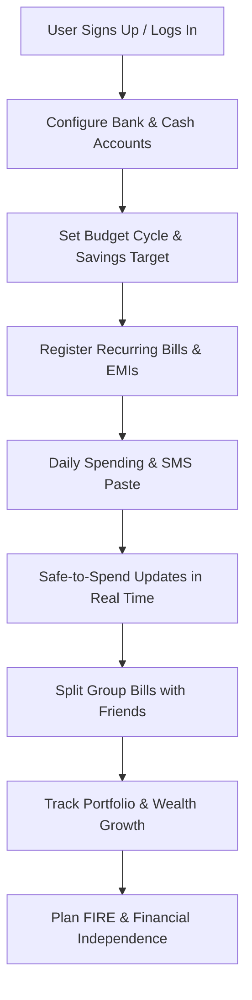
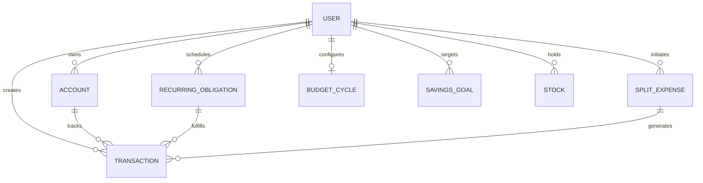

# FINFLOW — COMPLETE PROJECT EXPLANATION & ARCHITECTURAL GUIDE

---

## 1. PROJECT INTRODUCTION

### 1.1 What is FinFlow?
**FinFlow** is a modern, full-stack personal finance management platform and **Personal Financial Operating System (OS)** designed to eliminate financial anxiety. Unlike traditional budget trackers that only record past expenses, FinFlow acts as a proactive decision-making engine. It answers the single most critical question every consumer faces before making a discretionary purchase: 

> **"Can I safely afford to spend this money today without failing to pay my rent, bills, or EMIs next week?"**

By continuously analyzing liquid bank accounts, pending recurring obligations, upcoming budget cycle days, and peer debts, FinFlow calculates a real-time **Safe-to-Spend** number alongside a complete suite of wealth management, bill-splitting, SMS parsing, and investment projection tools.

---

### 1.2 Problems FinFlow Solves

1. **The "Bank Balance Illusion":**
   - *Problem:* A user checks their banking app, sees ₹45,000, and assumes they can spend ₹10,000 on a new gadget. Three days later, ₹30,000 rent and ₹8,000 insurance EMI are debited, triggering overdraft penalties or credit card debt.
   - *FinFlow Solution:* The **Safe-to-Spend Engine** deducts pending commitments and reserve buffers from liquid balances *before* displaying discretionary cash.

2. **Manual Transaction Logging Fatigue:**
   - *Problem:* Users abandon budgeting apps within two weeks because typing every transaction amount, merchant, and date is tedious.
   - *FinFlow Solution:* **Instant SMS & UPI Clipboard Parsing** extracts the amount, merchant, and date from bank notifications in one click without requiring insecure SMS device permissions.

3. **Bill Payment Surprises & Missed Due Dates:**
   - *Problem:* Subscriptions, utilities, and EMIs fall on random calendar days, leading to late fees.
   - *FinFlow Solution:* **Recurring Obligations Tracker** projects upcoming commitments, tracks paid/unpaid status per cycle, and automatically deducts unpaid obligations from daily spending allowances.

4. **Awkward Peer Debts & Forgotten Split Bills:**
   - *Problem:* Friends split dinner bills or road trips; tracking who paid whom across disparate chat threads results in forgotten money.
   - *FinFlow Solution:* **Peer Debt & Bill Split Engine ("Who Owes Me")** records individual debtor items, monitors settlements, and reflects pending receivables in the net worth overview.

5. **Disjointed Financial Tools:**
   - *Problem:* Users switch between 4 different apps: one for daily expenses, one for Splitwise, one for stock tracking, and a spreadsheet for retirement calculations.
   - *FinFlow Solution:* A unified dashboard bringing together multi-account balances, expense tracking, peer debts, live stock portfolios, 50/30/20 auto-budgeting, tax calculators, and FIRE projections.

---

### 1.3 Target Audience

| Segment | Pain Points Solved | Key Features Utilized |
| :--- | :--- | :--- |
| **Salaried Professionals** | Managing salary cycles, EMIs, credit card bills, and tax regimes. | Safe-to-Spend, Recurring Obligations, Tax Estimator, FIRE Projections |
| **College Students & Roommates** | Splitting rent, groceries, and dining with limited allowances. | Who Owes Me, SMS Parser, 50/30/20 Budgeting |
| **Freelancers & Gig Workers** | Irregular income dates, multiple bank accounts, cashflow volatility. | Multi-Account Management, Safety Buffer Controls, Stress Testing |
| **Young Investors** | Balancing monthly living costs with equity SIPs and long-term goals. | Stock Portfolio Tracker, Savings Goal Milestones, Rule of 72 |

---

### 1.4 30-Second Elevator Pitch
> *"Most personal finance apps are digital graveyard receipts—they tell you how you went broke after it already happened. FinFlow is a forward-looking financial operating system. By marrying your real liquid bank balances with your upcoming recurring obligations and custom savings goals, FinFlow tells you exactly what you can safely spend today in one clear number, parses bank SMS alerts instantly, recovers peer debts, and projects your journey to financial freedom."*

---

## 2. COMPLETE FEATURE EXPLANATION

FinFlow includes **21 production-verified features**. Below is an in-depth breakdown of each feature, its input requirements, underlying algorithm, resulting output, and practical user value.

```
+---------------------------------------------------------------------------------------------------------+
|                                        FINFLOW CORE CAPABILITIES                                        |
+------------------------------------+-----------------------------------+--------------------------------+
|        DAILY DECISION ENGINE       |       WEALTH & INVESTMENTS        |      ANALYTICS & PLANNING      |
+------------------------------------+-----------------------------------+--------------------------------+
|  1. Safe-to-Spend Engine           |  6. Net Worth Dashboard           |  8. Budget Management & Alerts |
|  2. Instant SMS / UPI Parser       | 10. Savings Goals & Milestones    |  9. Category Distribution      |
|  3. Recurring Obligations Tracker  | 11. Live Stock Portfolio          | 12. FIRE / Independence Model  |
|  4. Peer Debt Split ("Who Owes Me")| 14. Rule of 72 & Compound Math    | 13. 50/30/20 Auto-Budget       |
|  5. Multi-Account Liquidity Sync   | 20. Multi-Account Summary API     | 15. Tax & Deductions Simulator |
|  7. Income & Expense Ledger        |                                   | 16. Multi-Scenario Stress Test |
| 19. JWT Authentication Engine      |                                   | 17. Rule-Based AI Chatbot      |
| 21. Glassmorphic Responsive UI     |                                   | 18. Automated Cron Workers     |
+------------------------------------+-----------------------------------+--------------------------------+
```

---

### Feature 1: Safe-to-Spend Real-Time Engine
- **Purpose:** Calculates the exact amount a user can spend today without jeopardizing upcoming bills or savings goals.
- **Inputs:** Liquid account balances (`isLiquid: true`), unpaid recurring obligations due in the remaining cycle, monthly savings goal, minimum safety buffer, and remaining days in the budget cycle.
- **Processing Logic:**
  $$\text{Effective Liquid Cash} = \sum \text{Liquid Balances}$$
  $$\text{Cycle Commitments} = \text{Unpaid Obligations} + \text{Remaining Savings Target} + \text{Safety Buffer}$$
  $$\text{Safe To Spend (Monthly)} = \max(0, \text{Effective Liquid Cash} - \text{Cycle Commitments})$$
  $$\text{Daily Safe To Spend} = \frac{\text{Safe To Spend (Monthly)}}{\text{Days Remaining in Cycle}}$$
- **Outputs:** Monthly Safe-to-Spend, Daily Allowance, Cycle Days Remaining, and visual Health Status Badge (`HEALTHY`, `CAUTION`, `CRITICAL`).
- **Practical Value:** Protects users from overdrafts and impulse spending before rent or EMI due dates.

---

### Feature 2: Instant SMS & UPI Clipboard Parser
- **Purpose:** Automates transaction logging from copy-pasted bank SMS or UPI push alerts without asking for intrusive mobile OS SMS read permissions.
- **Inputs:** Raw notification text from Indian banks/UPI apps (HDFC, SBI, ICICI, Axis, Paytm, PhonePe, Google Pay).
- **Processing Logic:** Multi-pattern regular expression matching for:
  - Amount: `(?:INR|Rs\.?|₹)\s*([\d,]+(?:\.\d{1,2})?)`
  - Merchant / Payee: Keywords following `to|at|vpa|info|transfer to`
  - Transaction Type: `debited|spent|paid` (Expense) vs `credited|received|deposited` (Income)
  - Date & Reference Number: Clean regex extraction formatted in standard ISO notation without timezone drift.
- **Outputs:** Pre-filled interactive modal with parsed Amount, Type, Category, Merchant, and Date ready for one-click saving.
- **Practical Value:** Cuts transaction logging time from 45 seconds to 3 seconds.

---

### Feature 3: Recurring Obligations & Auto-Bill Tracker
- **Purpose:** Tracks mandatory monthly, weekly, or yearly bills, utilities, subscriptions, and EMIs.
- **Inputs:** Obligation title, amount, due day (1-31), category, frequency, and linked liquid account.
- **Processing Logic:** 
  - Dynamic due-date calculator adjusting for short months (e.g. Feb 28/29, April 30).
  - Status evaluation: compares linked transaction records within the current cycle to mark obligations as `PAID` or `PENDING`.
  - Feeds unpaid commitments straight into the Safe-to-Spend calculation.
- **Outputs:** Interactive bill schedule card with countdown days (`Due in 3 days`, `Overdue`), paid toggle, and one-click quick payment logger.
- **Practical Value:** Eliminates late payment penalties and avoids subscription surprises.

---

### Feature 4: Peer Debt & Bill Split Manager ("Who Owes Me")
- **Purpose:** Manages shared dining, travel, and household expenses without needing external apps like Splitwise.
- **Inputs:** Shared expense title, total amount, payer, split type (`EQUAL`, `EXACT`), debtor names, and individual share amounts.
- **Processing Logic:**
  - Automatically calculates individual debts and generates ledger entries.
  - Maintains individual payment status (`isPaid: true/false`).
  - Reconciles total outstanding receivables in the user's Net Worth calculation.
- **Outputs:** "Who Owes Me" widget displaying individual debtor pills, outstanding balances, and one-click "Mark as Settled" actions.
- **Practical Value:** Prevents forgotten personal loans and awkward debt reminders among friends.

---

### Feature 5: Multi-Account Liquidity Management
- **Purpose:** Aggregates balances across multiple bank accounts, cash wallets, and digital vaults while distinguishing liquid cash from locked funds.
- **Inputs:** Account name, type (`CHECKING`, `SAVINGS`, `WALLET`, `CASH`), current balance, and `isLiquid` toggle.
- **Processing Logic:**
  - Maintains individual account ledgers.
  - Isolates liquid funds (for Safe-to-Spend) from non-liquid or locked emergency reserves.
  - Adjusts balances atomically when transactions are logged or deleted.
- **Outputs:** Account cards showing live balances, liquidity status badges, and quick-add modals.
- **Practical Value:** Delivers a single glass-pane view of a user's total cash across multiple financial institutions.

---

### Feature 6: Real-Time Net Worth & Wealth Portfolio Dashboard
- **Purpose:** Provides a master financial snapshot combining cash, equity investments, outstanding peer debts, and liabilities.
- **Inputs:** Account balances, live stock valuations, uncollected split debts, and monthly expense aggregates.
- **Processing Logic:**
  $$\text{Net Worth} = \sum \text{Account Balances} + \sum \text{Stock CMP} + \sum \text{Peer Debts Receivable}$$
- **Outputs:** High-level metric cards for Net Worth, Total Liquid Cash, Total Debts Owed to User, and Monthly Burn Rate.
- **Practical Value:** Replaces cumbersome spreadsheets with real-time wealth tracking.

---

### Feature 7: Income & Expense Ledger with Categorization
- **Purpose:** Full CRUD transaction management supporting multi-category tagging and date filtering.
- **Inputs:** Transaction title, amount, category, type (`income` or `expense`), date, and optional account link.
- **Processing Logic:** Updates account balances, recalculates category totals, and maintains chronological pagination.
- **Outputs:** Sortable, filterable ledger table with search, category icons, delete confirmation, and income/expense toggles.
- **Practical Value:** Ensures transparent, audit-ready financial bookkeeping.

---

### Feature 8: Interactive Budget Management & Alerts
- **Purpose:** Enforces category-level spending limits with automated overspending warnings.
- **Inputs:** Category limits (e.g., Food: ₹10,000, Entertainment: ₹5,000) and budget cycle start day.
- **Processing Logic:** Compares current cycle expenditures against target caps and computes percent utilization.
- **Outputs:** Progress bars changing from green to amber to red with badge notifications when spending exceeds 80% or 100%.
- **Practical Value:** Alerts users before they breach monthly category budgets.

---

### Feature 9: Visual Financial Analytics & Distribution Charts
- **Purpose:** Transforms raw transaction tables into visual spending distributions and cash flow trends.
- **Inputs:** Chronological transaction records.
- **Processing Logic:** Aggregation pipelines grouping expenses by category and time interval (weekly/monthly).
- **Outputs:** Recharts-powered responsive Pie Charts, Donut Charts, and Bar Charts.
- **Practical Value:** Helps users identify subconscious spending leaks at a glance.

---

### Feature 10: Savings Goals Tracker with Milestone Progress
- **Purpose:** Tracks progress toward target savings goals (e.g., Emergency Fund, Europe Trip, Down Payment).
- **Inputs:** Goal title, target amount, current saved amount, target date, and monthly deposit rate.
- **Processing Logic:** Calculates completion percentage, required monthly savings rate, and projected completion date.
- **Outputs:** Visual milestone bars with celebration indicators when targets are met.
- **Practical Value:** Gamifies long-term saving and keeps users focused on major life goals.

---

### Feature 11: Live Stock Portfolio Tracker
- **Purpose:** Tracks equity investments with live market updates and profit/loss calculations.
- **Inputs:** Stock ticker (e.g. `RELIANCE.BSE`, `AAPL`), quantity, and average purchase price.
- **Processing Logic:**
  - Queries real-time or end-of-day market data via AlphaVantage API.
  - Features intelligent fallback to purchase price/mock market feed when API limits are reached.
  - Computes invested value, current market value, and unrealized P&L percentage.
- **Outputs:** Live portfolio table with green/red gain/loss indicators and total portfolio valuation.
- **Practical Value:** Merges equity investments with daily cash management in a single dashboard.

---

### Feature 12: Financial Independence & FIRE Projections
- **Purpose:** Calculates retirement readiness based on the 4% Safe Withdrawal Rule and custom savings rates.
- **Inputs:** Current age, target retirement age, current net worth, monthly investments, and expected annual return.
- **Processing Logic:** Compound growth simulation projecting annual wealth accumulation versus required FIRE corpus ($25 \times \text{Annual Expenses}$).
- **Outputs:** Interactive projection chart displaying the exact age and year financial independence is achieved.
- **Practical Value:** Empowers users to visualize the real-world impact of increasing their monthly savings rate.

---

### Feature 13: 50/30/20 Rule Auto-Budget Planner
- **Purpose:** Automatically divides monthly net income into the classic balanced budget formula: 50% Needs, 30% Wants, 20% Savings.
- **Inputs:** Total monthly take-home income.
- **Processing Logic:** Instant arithmetic allocation into Needs, Wants, and Savings buckets, comparing real spend against recommended buckets.
- **Outputs:** Visual comparison cards with actionable advice on which bucket is currently over-allocated.
- **Practical Value:** Simplifies financial planning for users intimidated by complex spreadsheets.

---

### Feature 14: Rule of 72 & Compound Interest Calculators
- **Purpose:** Interactive calculators demonstrating exponential growth and the time required to double wealth.
- **Inputs:** Principal amount, monthly SIP contribution, interest rate, and tenure.
- **Processing Logic:** Compound interest formula $A = P(1 + r/n)^{nt} + \text{PMT} \times \frac{(1 + r/n)^{nt} - 1}{r/n}$ and Rule of 72 ($T \approx 72 / r$).
- **Outputs:** Year-by-year growth curves displaying principal versus compound interest earned.
- **Practical Value:** Demonstrates the value of compounding and long-term investing.

---

### Feature 15: Tax & Deductions Simulator (India New vs Old Regime)
- **Purpose:** Compares tax liabilities between the Indian Old and New Tax Regimes to determine optimal tax savings.
- **Inputs:** Gross annual income, Section 80C deductions, 80D health insurance, HRA, and NPS contributions.
- **Processing Logic:** Step-by-step tax slab computation incorporating standard deductions and rebate under Section 87A.
- **Outputs:** Side-by-side comparison card displaying net payable tax and recommending the regime with lower tax liability.
- **Practical Value:** Saves users money during annual tax filing without requiring an accountant.

---

### Feature 16: Multi-Scenario Financial Stress Tester
- **Purpose:** Simulates the impact of unexpected financial shocks on personal cashflow and runway.
- **Inputs:** Current liquid savings, emergency buffer, monthly fixed obligations.
- **Processing Logic:** Models scenarios such as job loss (zero income for 6 months), market crash (30% drop in stock valuation), or emergency medical expenses (₹2,00,000 lump sum).
- **Outputs:** Survival runway metrics (in months) and liquidity breach warnings.
- **Practical Value:** Prepares users for black-swan events before they happen.

---

### Feature 17: Rule-Based AI Financial Advisory Chatbot
- **Purpose:** On-demand financial assistant offering tailored budgeting tips, metric lookups, and financial guidance.
- **Inputs:** User natural language prompts (e.g., "How much can I spend today?", "What is my largest expense?", "How do I start an emergency fund?").
- **Processing Logic:** Keyword pattern recognition and contextual state lookup mapping user questions to live financial metrics.
- **Outputs:** Conversational replies with relevant financial data and links to features.
- **Practical Value:** Gives users an instant conversational interface to their financial data.

---

### Feature 18: Automated Cron Workers
- **Purpose:** Background maintenance for periodic financial calculations.
- **Inputs:** Scheduled node-cron triggers.
- **Processing Logic:**
  - Nightly stock price updates.
  - End-of-cycle budget rollovers and recurring obligation status resets.
- **Outputs:** Silent, self-healing background updates ensuring dashboards display fresh metrics every morning.
- **Practical Value:** Eliminates the need for manual user refreshes and recalculations.

---

### Feature 19: Secure JWT Authentication & Session Engine
- **Purpose:** Safeguards financial data with industry-standard encryption and stateless authentication.
- **Inputs:** User email, username, and password.
- **Processing Logic:**
  - Password hashing via `bcryptjs` with salt rounds.
  - Signed JSON Web Tokens (JWT) containing encrypted user IDs with expiration policies.
  - Express authorization middleware guarding all `/api/*` endpoints.
- **Outputs:** Secure Bearer tokens, HTTP session state, and persistent authentication across page reloads.
- **Practical Value:** Guarantees total data privacy and protects users against unauthorized access.

---

### Feature 20: Multi-Account Reconciled Financial Summary API
- **Purpose:** Single consolidated API endpoint (`/api/summary`) powering dashboard widgets in one lightweight round-trip.
- **Inputs:** Authenticated user token.
- **Processing Logic:** Parallel Mongoose queries across Accounts, Transactions, Obligations, Splits, and Stocks, computing liquid totals and NaN-guarded percentages.
- **Outputs:** Unified JSON payload containing Net Worth, Liquid Cash, Safe-to-Spend summary, and recent transaction history.
- **Practical Value:** Minimizes network payload and ensures ultra-fast page load times.

---

### Feature 21: Dynamic Theme & Responsive Glassmorphic UI
- **Purpose:** Modern visual interface delivering high readability across all screen sizes.
- **Inputs:** Viewport width and theme preferences.
- **Processing Logic:** Tailwind CSS responsive breakpoints (`sm:`, `md:`, `lg:`, `xl:`) with dark glassmorphism styling and Framer Motion micro-animations.
- **Outputs:** Smooth, adaptive UI with mobile bottom navigation, desktop sidebars, and fluid charts.
- **Practical Value:** Delivers a premium, native-app-like user experience on desktop, tablet, and mobile.

---

## 3. HOW FINFLOW WORKS — STEP-BY-STEP USER JOURNEY



### Step 1: Onboarding & Authentication
The user visits FinFlow, creates a secure account with their email and password, and receives a signed JWT. On future visits, session persistence keeps them logged in.

### Step 2: Multi-Account Setup
The user navigates to the **Accounts** tab and registers their accounts:
- HDFC Salary Checking: ₹55,000 (Liquid)
- ICICI Emergency Savings: ₹1,00,000 (Liquid)
- Cash in Wallet: ₹3,500 (Liquid)
- Fixed Deposit: ₹2,00,000 (Non-Liquid)
*FinFlow calculates Total Liquid Cash: ₹1,58,500.*

### Step 3: Budget Cycle & Safety Buffer
The user configures their monthly salary cycle:
- Cycle Start Day: 1st of the month
- Monthly Savings Target: ₹25,000
- Safety Buffer: ₹10,000 (funds never to be touched)

### Step 4: Recurring Bills & Obligations
The user records their regular monthly commitments:
- Apartment Rent: ₹25,000 (Due on the 5th)
- WiFi Bill: ₹1,200 (Due on the 12th)
- Car EMI: ₹14,000 (Due on the 20th)
- Netflix: ₹649 (Due on the 28th)
*Total Upcoming Commitments: ₹40,849.*

### Step 5: Day-to-Day Spending & Instant SMS Parsing
When purchasing groceries or coffee, the user copies their bank SMS notification and pastes it into FinFlow's **Quick Paste Modal**. The parser automatically extracts:
`"Debited INR 850.00 at STARBUCKS on 16-11-2026"` $\rightarrow$ Amount: ₹850, Type: Expense, Category: Food & Dining. The user clicks **Add Transaction**, and their liquid checking balance updates immediately.

### Step 6: Shared Outings & Bill Splitting
After a weekend road trip, the user pays a ₹6,000 fuel and toll bill. In the **Split Expenses** tab, they enter the bill and add two friends (Amit and Sneha) with an equal split of ₹2,000 each. FinFlow records ₹4,000 under "Who Owes Me", adding it to their receivable assets. When Amit pays back via UPI, one click marks his share as settled.

### Step 7: Safe-to-Spend Daily Checks
Before shopping for electronics, the user opens the dashboard. The **Safe-to-Spend Widget** displays:
- **Liquid Cash Available:** ₹1,57,650
- **Reserved Commitments:** ₹40,849 (Bills) + ₹25,000 (Savings) + ₹10,000 (Buffer) = ₹75,849
- **Safe-to-Spend for Month:** ₹81,801
- **Daily Safe-to-Spend (14 days remaining):** ₹5,842/day
The user knows with certainty that spending ₹4,000 today will not impact their rent or savings.

### Step 8: Investment & Net Worth Tracking
The user logs their mutual fund and equity holdings (e.g. 50 shares of TCS and 100 shares of Infosys). FinFlow tracks live market prices and updates their consolidated Net Worth in real time.

### Step 9: Long-Term Financial Planning
In the **Tools & Calculators** section, the user tests their retirement age using the **FIRE Simulator**, checks whether the Old or New Tax Regime saves them more tax, and stresses their emergency runway against a hypothetical 6-month career break.

---

## 4. TECHNOLOGY STACK BREAKDOWN

```
+---------------------------------------------------------------------------------------------------------+
|                                         FINFLOW ARCHITECTURE                                            |
+---------------------------------------------------------------------------------------------------------+
|   FRONTEND LAYER (Client)                                                                               |
|   React 19 | Tailwind CSS | Recharts | Framer Motion | Lucide Icons | Axios | Jest / RTL                |
+---------------------------------------------------------------------------------------------------------+
                                           |  HTTPS / REST / JSON (JWT Auth)
                                           v
+---------------------------------------------------------------------------------------------------------+
|   BACKEND API LAYER (Node.js Server)                                                                    |
|   Node.js 26 | Express 5 | JWT Auth Middleware | Node Test Runner | Node-Cron                           |
+---------------------------------------------------------------------------------------------------------+
                                           |  Mongoose ODM (Driver v9.x)
                                           v
+---------------------------------------------------------------------------------------------------------+
|   PERSISTENCE LAYER (Database)                                                                          |
|   MongoDB Database | BSON | Compound Indexes | Document Level Aggregations                              |
+---------------------------------------------------------------------------------------------------------+
```

### 4.1 Frontend Architecture
- **React 19:** Utilizes modern functional components, hooks (`useState`, `useEffect`, `useMemo`, `useCallback`), and optimized reconciliation for fast rendering.
- **Tailwind CSS:** Modern utility-first styling with responsive grid layouts, custom gradients, and dark glassmorphism effects.
- **Recharts:** Composable SVG-based chart library powering interactive pie charts, area trends, and historical spending bars.
- **Framer Motion:** Delivers micro-interactions, animated modal transitions, and metric counters.
- **Lucide React:** Lightweight, consistent icon set providing visual cues for financial categories and navigation.
- **Axios:** Handles asynchronous HTTP requests with authorization header interceptors.
- **Jest & React Testing Library:** Unit and component testing verifying user interaction and rendering accuracy.

### 4.2 Backend Architecture
- **Node.js (v26 LTS):** Asynchronous, event-driven JavaScript runtime delivering fast I/O performance.
- **Express 5:** Next-generation web framework featuring native Promise rejections in route handlers and streamlined middleware pipelines.
- **JSON Web Tokens (JWT):** Stateless authentication tokens passed in `Authorization: Bearer <token>` headers.
- **Bcrypt.js:** Industry-standard password hashing with adaptive salt work factors.
- **Node.js Built-in Test Runner (`node --test`):** Lightweight, zero-dependency test suite running integration and unit tests without external overhead.
- **Node-Cron:** Background task scheduler for recurring obligations and market price updates.

### 4.3 Database Layer
- **MongoDB:** Flexible, document-oriented NoSQL database well-suited for nested financial documents (splits, obligations, portfolio items).
- **Mongoose 9:** ODM providing strict schema definitions, type casting, validation, and compound indexes.

---

## 5. DATABASE ARCHITECTURE

### 5.1 Why MongoDB?
Personal finance applications handle diverse, evolving data structures. An expense might be a simple cash coffee purchase, an itemized split bill with four debtors, or an automated recurring EMI payment. MongoDB's flexible BSON document model allows seamless embedding of debtors and references without the rigid migration overhead of relational schemas, while Mongoose provides strong schema enforcement and data validation at the application tier.

### 5.2 Schema Relationship Diagram



### 5.3 Mongoose Schemas & Data Integrity

1. **User Schema (`models/User.js`):**
   - Fields: `name`, `email` (unique index), `password` (hashed).
   - Security: Pre-save hook hashes passwords; API responses omit the password field.

2. **Account Schema (`models/Account.js`):**
   - Fields: `userId` (indexed), `name`, `type` (`CHECKING`, `SAVINGS`, `WALLET`, `CASH`), `currentBalance`, `currency`, `isLiquid`, `isActive`.
   - Integrity: Balances are updated via ledger transactions.

3. **Transaction Schema (`models/Transaction.js`):**
   - Fields: `userId` (indexed), `title`, `amount`, `category`, `type` (`income`/`expense`), `date`, `accountId`, `obligationId`, `splitExpenseId`, `source` (`MANUAL`, `SMS_PASTE`, `IMPORT`).
   - Indexes: Compound index on `{ userId: 1, date: -1 }` for rapid history lookups.

4. **RecurringObligation Schema (`models/RecurringObligation.js`):**
   - Fields: `userId` (indexed), `accountId`, `title`, `amount`, `dueDay`, `category`, `frequency`, `isActive`, `nextDueDate`.

5. **BudgetCycle Schema (`models/BudgetCycle.js`):**
   - Fields: `userId` (unique), `cycleStartDay` (1-31), `monthlySavingsGoal`, `minSafetyBuffer`, `currency`.

6. **SplitExpense Schema (`models/SplitExpense.js`):**
   - Fields: `userId`, `title`, `totalAmount`, `payerName`, `splitType`, `debtors` array (`[{ name, amount, isPaid, settledAt }]`).

7. **Stock Schema (`models/Stock.js`):**
   - Fields: `userId`, `ticker`, `shares`, `avgPrice`, `cmp`, `lastUpdated`.

---

### 5.4 Financial Arithmetic & Precision Handling
JavaScript numbers use IEEE 754 double-precision floating-point arithmetic, which can introduce subtle rounding errors (e.g., `0.1 + 0.2 === 0.30000000000000004`). FinFlow enforces financial precision using two complementary safeguards:
1. **Application-Level Decimal Rounding:** All monetary aggregations, subtractions, and split fractions are rounded via strict precision helpers (`Math.round(val * 100) / 100`) to guarantee that cents/paise are never lost.
2. **Safe Division Guards:** In metric calculations (such as portfolio percentages, budget utilization, and Safe-to-Spend daily divisions), all divisors are checked for zero and nullity, returning deterministic zero values rather than `NaN` or `Infinity`.

---

## 6. REAL-LIFE PRACTICAL SCENARIOS

### Scenario 1: The Month-End Illusion (Rahul, Software Engineer, Bangalore)
- **Context:** Rahul has ₹60,000 in his bank account on the 20th of the month. He sees an online sale for a ₹25,000 tablet.
- **Without FinFlow:** Rahul buys the tablet. On the 28th, his ₹30,000 rent and ₹8,000 car EMI are scheduled for auto-debit. His account falls to ₹-3,000, incurring an overdraft penalty and credit card borrowing costs.
- **With FinFlow:** Rahul checks FinFlow's **Safe-to-Spend Widget**. FinFlow calculates:
  - Account Balance: ₹60,000
  - Upcoming Unpaid Obligations: ₹30,000 (Rent) + ₹8,000 (Car EMI) = ₹38,000
  - Safety Buffer: ₹10,000
  - **Safe-to-Spend:** ₹12,000 (or ₹1,200/day for the remaining 10 days)
  - FinFlow displays a yellow **CAUTION** badge warning that a ₹25,000 expense exceeds his safe spending limit. Rahul defers the purchase until after his next salary credit, avoiding debt entirely.

---

### Scenario 2: The Goa Trip Bill Split (Priya, Designer, Mumbai)
- **Context:** Priya and three friends spend a weekend in Goa. Priya pays ₹12,000 for villa rental, ₹4,800 for dinner, and ₹2,400 for local cabs.
- **Without FinFlow:** Over three days, receipts are scattered across paper bills and WhatsApp messages. Friends forget who paid for cabs, and Priya ends up absorbing ₹3,500 of unpaid expenses.
- **With FinFlow:** Priya opens the **Split Expenses** tab after each activity:
  1. Villa: ₹12,000 split equally among 4 people (₹3,000 each for Amit, Rohan, Sneha).
  2. Dinner: ₹4,800 split equally (₹1,200 each).
  3. Cabs: ₹2,400 split equally (₹600 each).
  - FinFlow aggregates these into the **"Who Owes Me"** widget, showing Amit owes ₹4,800, Rohan owes ₹4,800, and Sneha owes ₹4,800 (Total: ₹14,400).
  - As each friend transfers their share via UPI, Priya clicks **"Mark Settled"**. Her net worth updates dynamically, and no money is lost.

---

### Scenario 3: The Freelancer's Irregular Cashflow (Vikram, Full-Stack Freelancer, Pune)
- **Context:** Vikram receives client payments unpredictably: ₹80,000 one month, ₹20,000 the next. He holds funds across three accounts: a business checking account, a personal savings account, and cash.
- **Without FinFlow:** In lean months, Vikram panics because his personal account balance drops, even though his business account holds reserved funds.
- **With FinFlow:** Vikram configures all three accounts in FinFlow and marks his personal savings and checking accounts as **Liquid**. He sets a **Safety Buffer of ₹30,000** in his Budget Cycle.
  - FinFlow combines his liquid balances and deducts his safety buffer, giving him a unified, panic-free view of how many days of runway remain regardless of which account holds the funds.

---

### Scenario 4: The Salaried Professional with SIPs & EMIs (Ananya, Product Manager, Delhi)
- **Context:** Ananya earns ₹1,20,000/month. She has 2 SIPs of ₹10,000 each, an apartment loan EMI of ₹42,000, utility bills of ₹5,000, and aims to save ₹15,000 for an international vacation.
- **Without FinFlow:** Ananya tracks expenses in a spreadsheet on weekends. When busy, she skips logging for three weeks and misses tracking cash spent at local markets.
- **With FinFlow:** 
  - All recurring investments and EMIs are scheduled in **Recurring Obligations**.
  - All daily UPI payments are logged in 3 seconds via the **SMS / Clipboard Parser**.
  - The **50/30/20 Budget Planner** automatically confirms that her ₹42,000 EMI + ₹5,000 utilities fall under the 50% Needs threshold, while her SIPs hit her 20% Savings target.

---

### Scenario 5: Financial Independence Planning (Rohan, Age 28, Hyderabad)
- **Context:** Rohan wants to retire at age 45 with a monthly inflation-adjusted lifestyle budget of ₹75,000.
- **Without FinFlow:** Retirement seems like an abstract, distant number with no clear milestone targets.
- **With FinFlow:** Rohan uses the **FIRE Projections Calculator**:
  - Current Age: 28 | Target Age: 45
  - Current Net Worth: ₹8,50,000 | Monthly SIP: ₹35,000 | Expected Annual Return: 12%
  - FinFlow projects his portfolio growth over 17 years and plots it against his required FIRE corpus ($25 \times \text{Annual Expenses} = ₹2.25\text{ Crores}$).
  - The simulation demonstrates that increasing his SIP by just ₹5,000/month accelerates his FIRE milestone by 2.5 years.

---

## 7. UNIQUE VALUE PROPOSITION

### How FinFlow Compares to Traditional Financial Apps

| Capability / Feature | FinFlow | Splitwise | Walnut / Axio | Mint / YNAB | Excel Sheets |
| :--- | :---: | :---: | :---: | :---: | :---: |
| **Real-Time Safe-to-Spend Calculation** | **YES (Dynamic)** | NO | NO | Partial (YNAB) | NO |
| **Instant SMS & UPI Parsing** | **YES (No permissions needed)** | NO | YES (Reads SMS) | NO | NO |
| **Integrated Peer Debt ("Who Owes Me")** | **YES (Built-in)** | YES | NO | NO | Manual |
| **Multi-Account Liquidity Segregation** | **YES** | NO | Partial | YES | Manual |
| **Live Equity / Stock Portfolio Tracking** | **YES** | NO | NO | NO | Manual |
| **FIRE & Compound Growth Calculators** | **YES** | NO | NO | NO | Formulas |
| **50/30/20 Auto-Budget Engine** | **YES** | NO | NO | Partial | Formulas |
| **Indian Tax Regime Simulator** | **YES** | NO | NO | NO | Formulas |
| **Financial Stress Testing** | **YES** | NO | NO | NO | NO |
| **AI Advisory Chatbot** | **YES** | NO | NO | NO | NO |
| **Privacy (No Bank Scraping / Password Sharing)**| **100% Private** | N/A | Low (Reads inbox) | Low (Bank creds) | 100% Private |

---

## 8. 5-MINUTE LIVE DEMO SCRIPT

This step-by-step presentation script is designed for live demonstrations, stakeholder reviews, or viva examinations.

```
+-------------------------------------------------------------------------------+
|                        5-MINUTE DEMO TIMELINE                                 |
+------------+------------------------------------------------------------------+
| 0:00 - 1:00| Problem Introduction & Instant Login                             |
| 1:00 - 2:00| Multi-Account Setup & Instant SMS Parsing                        |
| 2:00 - 3:00| The Safe-to-Spend Breakthrough & Recurring Obligations          |
| 3:00 - 4:00| Peer Debt Bill Splitting & "Who Owes Me" Settlement              |
| 4:00 - 5:00| Net Worth Portfolio, FIRE Projections & Conclusion              |
+------------+------------------------------------------------------------------+
```

### Minute 0:00 - 1:00: Problem Introduction & Instant Login
- **What to Click:** Open browser to `http://localhost:3000`, enter demo credentials (`alex@example.com` / `password123`), click **Sign In**.
- **What to Show:** The glassmorphic Dashboard loading instantly with live metric cards.
- **What to Say:**
  > *"Good morning. Today, over 80% of urban professionals suffer from the 'Bank Balance Illusion'—they see ₹50,000 in their bank account today, spend freely, and wake up next week unable to pay their rent or EMIs without taking on debt. Existing expense trackers are backward-looking graveyards of past spend. Welcome to **FinFlow**—a forward-looking Financial Operating System designed to make your money safe."*

### Minute 1:00 - 2:00: Multi-Account Setup & Instant SMS Parsing
- **What to Click:** Click **Accounts** on the sidebar, highlight the HDFC Checking, ICICI Savings, and Cash accounts. Then click the **Quick Paste (SMS / UPI)** button in the top navigation bar.
- **What to Show:** Paste a sample bank SMS: `"Dear Customer, your A/C ending 4092 is debited by INR 1,450.00 on 16-Nov-2026 at SWIGGY. Ref: 489210"`.
- **What to Say:**
  > *"FinFlow tracks multi-account liquidity, distinguishing real spending cash from locked reserves. And instead of forcing users to manually type 6 fields for every coffee or lunch, our Instant SMS/UPI Parser extracts the merchant, amount, category, and date directly from the clipboard with zero permissions required. One click, and it is saved to our ledger."*

### Minute 2:00 - 3:00: The Safe-to-Spend Breakthrough & Obligations
- **What to Click:** Return to **Dashboard** and zoom into the **Safe-to-Spend Widget** and **Recurring Obligations** card.
- **What to Show:** The dynamic Safe-to-Spend monthly and daily numbers, with the green "HEALTHY" status badge.
- **What to Say:**
  > *"Here is the crown jewel of FinFlow: the **Safe-to-Spend Engine**. Notice that while our total liquid balance is ₹85,000, our Safe-to-Spend is ₹32,000. Why? Because FinFlow automatically deducted upcoming unpaid obligations—like our upcoming ₹25,000 apartment rent and ₹10,000 minimum safety buffer. It tells the user: you have exactly ₹1,600 safe to spend today. If you stay under that, your bills and savings goals are mathematically guaranteed to succeed."*

### Minute 3:00 - 4:00: Peer Debt Bill Splitting & "Who Owes Me"
- **What to Click:** Navigate to **Split Expenses** tab. Show an existing group dinner split. Click the green **"Settle"** button next to a debtor's name.
- **What to Show:** The debtor's tag changes to `SETTLED`, and the "Who Owes Me" outstanding total updates immediately.
- **What to Say:**
  > *"We have all experienced splitting bills on trips and forgetting who owes what. FinFlow features a native 'Who Owes Me' peer debt engine. When you pay for a shared meal, it logs each friend's share and tracks them until settled. Most importantly, it treats pending debts as receivable assets, integrating them directly into your net worth."*

### Minute 4:00 - 5:00: Net Worth Portfolio, FIRE Projections & Conclusion
- **What to Click:** Scroll to the **Stock Portfolio & FIRE Projections** section. Show live stock valuations, the 50/30/20 auto-budget breakdown, and the interactive retirement growth curve.
- **What to Show:** Hover over the FIRE growth chart, showing retirement readiness at age 48.
- **What to Say:**
  > *"Finally, FinFlow scales from today's ₹100 coffee purchase all the way to your 20-year retirement plan. With real-time equity portfolio tracking, automatic 50/30/20 budgeting, and financial independence modeling, FinFlow replaces four disconnected apps with one unified platform. Thank you, and I look forward to your questions."*

---

## 9. PROJECT VIVA / INTERVIEW QUESTIONS & ANSWERS

### 1. What is the core architectural philosophy behind FinFlow?
**Answer:** FinFlow is built on the philosophy of a **proactive financial operating system** rather than a passive expense tracker. Passive trackers record historical expenditures; FinFlow calculates forward-looking discretionary allowances (Safe-to-Spend) by reconciling liquid cash, pending recurring commitments, budget cycles, and peer debts.

### 2. Why did you choose Express 5 and Node.js for the backend?
**Answer:** Express 5 provides native support for Promise rejections in route handlers, eliminating the need for boilerplate `asyncHandler` wrappers. Combined with Node.js's asynchronous non-blocking I/O, it efficiently handles concurrent database requests and background cron jobs with minimal resource overhead.

### 3. How does FinFlow solve the IEEE 754 floating-point inaccuracy issue?
**Answer:** In JavaScript, binary floating-point representation can cause rounding anomalies (e.g. `0.1 + 0.2 !== 0.3`). FinFlow resolves this by executing all financial calculations with strict decimal rounding helpers (`Math.round(val * 100) / 100`) and using zero-guarded divisions to ensure balances and percentage distributions remain mathematically exact.

### 4. Explain the Safe-to-Spend mathematical formula.
**Answer:**
$$\text{Safe-to-Spend} = \max\left(0, \sum \text{Liquid Accounts} - \sum \text{Unpaid Cycle Obligations} - \text{Savings Goal} - \text{Safety Buffer}\right)$$
The daily allowance is obtained by dividing the monthly Safe-to-Spend by the remaining days in the user's active budget cycle.

### 5. How does FinFlow ensure multi-tenant data isolation?
**Answer:** Multi-tenancy is enforced at the database query level. Every protected route passes through the JWT authentication middleware (`middleware/auth.js`), which verifies the cryptographic signature of the token and injects `req.user.id`. Every Mongoose query explicitly filters by `{ userId: req.user.id }`, making it impossible for a user to read or modify another user's financial records.

### 6. Why did you implement an SMS clipboard parser instead of reading SMS automatically via Android APIs?
**Answer:** Privacy and cross-platform accessibility. Requesting `READ_SMS` permissions on mobile devices introduces severe security and regulatory barriers, and cannot run in standard web browsers. FinFlow's clipboard parser allows users to copy any bank notification and extract the amount, merchant, and date with zero permissions, working identically across iOS, Android, and desktop browsers.

### 7. How does the Recurring Obligations tracker handle months with varying numbers of days (e.g., February)?
**Answer:** In `services/budgetEngine.js`, the next due date algorithm detects month lengths. If an obligation is scheduled for day 31, but the current month has only 28 or 30 days, the calculation clamps the due date to the final valid day of that calendar month, preventing skipped cycles or invalid dates.

### 8. What is the difference between Liquid and Non-Liquid accounts in FinFlow?
**Answer:** Liquid accounts (`isLiquid: true`, such as checking accounts, liquid savings, and cash) are immediately spendable and feed directly into the Safe-to-Spend calculation. Non-liquid accounts (such as fixed deposits, provident funds, or real estate) contribute to overall Net Worth but are excluded from daily spendable cash to protect reserves from impulsive spending.

### 9. How are peer debts ("Who Owes Me") reconciled with Net Worth?
**Answer:** When a user pays for a group expense, their cash drops by the full amount, but their split receivable increases by the sum of their friends' shares. FinFlow adds uncollected debts (`isPaid: false`) as an asset in the Net Worth formula:
$$\text{Net Worth} = \text{Liquid Cash} + \text{Investments} + \text{Unsettled Receivables} - \text{Liabilities}$$

### 10. How does the application handle AlphaVantage API rate limiting?
**Answer:** In `routes/stocks.js`, stock quote fetching is wrapped in a resilient fallback handler. If the API key is unconfigured, returns an HTTP error, or reaches its free-tier rate limit (25 requests/day), the route gracefully falls back to the user's recorded purchase price (`avgPrice`) or last-known market price (`cmp`), ensuring the UI never crashes.

### 11. What database indexes are configured in FinFlow and why?
**Answer:** 
- `Transaction`: Compound index on `{ userId: 1, date: -1 }` for rapid chronological querying of ledgers and charts.
- `Account`: Compound index on `{ userId: 1, isLiquid: 1 }` for fast Safe-to-Spend liquid balance aggregations.
- `User`: Unique index on `email` to guarantee unique accounts and instant authentication lookups.

### 12. Explain how the 50/30/20 budget planner works.
**Answer:** The planner takes the user's net income and allocates 50% to Needs (groceries, rent, utilities), 30% to Wants (dining, hobbies, subscriptions), and 20% to Savings/Investments (SIPs, debt repayment). It compares current category expenditures against these benchmarks to visually highlight over-allocated buckets.

### 13. What happens if the MongoDB connection is dropped or offline during startup?
**Answer:** `server.js` starts the Express HTTP server immediately on port 5000 and attempts connection asynchronously. If MongoDB is offline, it logs helpful setup guidance instead of crashing with an unhandled rejection, allowing health check endpoints to respond properly.

### 14. How are password credentials protected?
**Answer:** Passwords are never stored in plaintext. Mongoose pre-save hooks hash passwords using `bcryptjs` with salt rounds. During login, `bcrypt.compare()` verifies credentials. User query projections explicitly exclude the `password` field (`select("-password")`).

### 15. How do you prevent duplicate transaction submissions in the frontend?
**Answer:** Form submission buttons maintain internal loading states (`isLoading: true`) that disable the button and render a loading spinner during API flight, preventing duplicate clicks.

### 16. What testing strategies are implemented in FinFlow?
**Answer:** FinFlow utilizes a dual-tier testing strategy:
1. **Backend Integration & Unit Tests:** Powered by the Node.js built-in test runner (`node --test`), testing the budget engine, SMS parser, account balances, split settlements, and summary APIs across 18 automated test suites.
2. **Frontend Component Tests:** Powered by Jest and React Testing Library, testing the rendering, mock state, and user interactions of widgets like Safe-to-Spend, Obligations, and Quick Paste modals.

### 17. How does the FIRE calculator compute retirement readiness?
**Answer:** It applies the **4% Safe Withdrawal Rule** (the Trinity Study benchmark). It computes the target retirement corpus as:
$$\text{FIRE Corpus} = \text{Annual Living Expenses} \times 25$$
It then projects compound growth of current investments and monthly contributions against this threshold.

### 18. What is the role of Node-Cron in the system?
**Answer:** Node-Cron runs background worker jobs. In `cron/schedular.js`, scheduled tasks trigger price updates and reset periodic obligation statuses at the beginning of each budget cycle without requiring manual user intervention.

### 19. How does the frontend handle responsive layouts across mobile and desktop?
**Answer:** Using Tailwind CSS responsive breakpoints (`sm:`, `md:`, `lg:`, `xl:`), the UI renders a collapsible desktop sidebar with top metrics on wide screens, and transitions to a compact mobile bottom navigation bar with vertical scroll cards on screens under 768px.

### 20. If FinFlow were deployed to production today, what would the architecture look like?
**Answer:** 
- Frontend: Static asset build hosted on a CDN or edge platform (Vercel, Netlify, or AWS S3 + CloudFront).
- Backend: Containerized Docker service hosted on AWS ECS, Render, or Railway.
- Database: Managed MongoDB Atlas cluster with automated backups and replica sets.
- Security: HTTPS via TLS certificates, secure HTTP-only cookies or encrypted headers, and CORS restricted to the frontend production domain.

---

## 10. FUTURE IMPROVEMENTS ROADMAP

To maintain full transparency, here is the clear distinction between what is **currently implemented and verified** versus **planned future enhancements**:

```
+---------------------------------------------------------------------------------------------------------+
|                                    IMPLEMENTED VS PLANNED ROADMAP                                       |
+--------------------------------------------------------------------+------------------------------------+
|                CURRENTLY IMPLEMENTED & VERIFIED                    |         PLANNED FUTURE ENHANCEMENTS        |
+--------------------------------------------------------------------+------------------------------------+
| [x] Safe-to-Spend Real-Time Engine                                 | [ ] Reserve Bank of India (RBI)    |
| [x] Multi-Account Liquidity Management                             |     Account Aggregator integration |
| [x] Instant SMS & UPI Clipboard Parser                             | [ ] OCR Receipt Camera Scanning    |
| [x] Recurring Obligations & Auto-Bill Tracker                      | [ ] Native React Native Mobile App |
| [x] Peer Debt & Bill Split ("Who Owes Me")                         | [ ] Automated Webhook Alerts via   |
| [x] Full Income / Expense CRUD with Tagging                        |     WhatsApp or Telegram           |
| [x] Interactive Budget Management & Alerts                         | [ ] Multi-Currency Conversion with |
| [x] Recharts Visual Distribution Analytics                         |     live FOREX exchange rates      |
| [x] Savings Goals & Milestone Progress                             | [ ] Shared Household Accounts     |
| [x] Live Stock Portfolio Tracker (with API Fallback)               |     with role-based access         |
| [x] FIRE & Financial Independence Simulator                        |                                    |
| [x] 50/30/20 Auto-Budget Engine                                    |                                    |
| [x] Rule of 72 & Compound Interest Calculators                     |                                    |
| [x] Indian Tax Regime Simulator (New vs Old)                       |                                    |
| [x] Financial Stress Testing Simulator                             |                                    |
| [x] Rule-Based AI Advisory Chatbot                                 |                                    |
| [x] Node-Cron Scheduled Background Workers                         |                                    |
| [x] Secure JWT Authentication & Session Engine                     |                                    |
| [x] Consolidated /api/summary Route                                |                                    |
| [x] Glassmorphic Responsive Dark UI                                |                                    |
+--------------------------------------------------------------------+------------------------------------+
```

---
*Documentation compiled and verified for FinFlow v2.0.*
