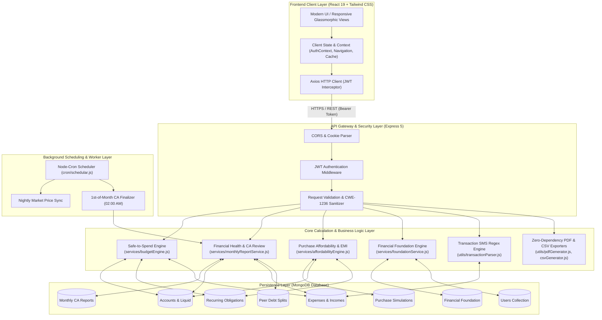
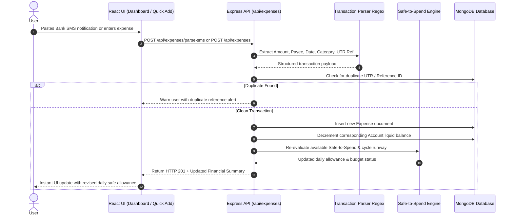

<div align="center">

```
███████╗██╗███╗   ██╗███████╗██╗      ██████╗ ██╗    ██╗
██╔════╝██║████╗  ██║██╔════╝██║     ██╔═══██╗██║    ██║
█████╗  ██║██╔██╗ ██║█████╗  ██║     ██║   ██║██║ █╗ ██║
██╔══╝  ██║██║╚██╗██║██╔══╝  ██║     ██║   ██║██║███╗██║
██║     ██║██║ ╚████║██║     ███████╗╚██████╔╝╚███╔███╔╝
╚═╝     ╚═╝╚═╝  ╚═══╝╚═╝     ╚══════╝ ╚═════╝  ╚══╝╚══╝
```

# FinFlow — Personal Financial Operating System

**Track every rupee. Defend your safety nets. Simulate major purchases. Compound your future wealth.**

[](https://nodejs.org/)
[](https://react.dev/)
[](https://expressjs.com/)
[](https://www.mongodb.com/)
[](https://tailwindcss.com/)
[](#-automated-testing--quality-assurance)
[](LICENSE)

</div>

---

## 📑 Table of Contents

- [Overview](#-overview)
- [Key Features](#-key-features)
- [System Design & Architecture](#-system-design--architecture)
  - [1. High-Level Architecture](#1-high-level-architecture)
  - [2. Component & Layer Responsibility](#2-component--layer-responsibility)
  - [3. Transaction Lifecycle & Data Flow](#3-transaction-lifecycle--data-flow)
  - [4. Core Mathematical Engines](#4-core-mathematical-engines)
  - [5. Entity-Relationship Data Model](#5-entity-relationship-data-model)
  - [6. Security & Fault Tolerance](#6-security--fault-tolerance)
- [Project Directory Structure](#-project-directory-structure)
- [Complete API Reference](#-complete-api-reference)
- [Getting Started & Local Setup](#-getting-started--local-setup)
- [Automated Testing & Quality Assurance](#-automated-testing--quality-assurance)
- [Step-by-Step Git Commands to Push to GitHub](#-step-by-step-git-commands-to-push-to-github)
- [License & Acknowledgments](#-license--acknowledgments)

---

## 🌟 Overview

**FinFlow** is a modern, production-grade **Personal Financial Operating System** designed to bridge the gap between simple expense tracking and institutional-grade personal financial management. 

Traditional budgeting apps passively list past transactions. FinFlow actively protects your financial future by calculating your **real-time daily Safe-to-Spend allowance**, auditing your monthly financial health with an automated **Personal CA Report**, simulating major purchase decisions before money leaves your account (**Can I Afford It?**), and reinforcing core financial habits with a **28-rule Financial Rulebook** and **12 interactive calculators**.

---

## ⚡ Key Features

| Feature Module | Core Functionality | Real-World Value |
| :--- | :--- | :--- |
| **🛡️ Safe-to-Spend Engine** | Deducts upcoming bills, savings goals, and emergency buffers from liquid cash to compute daily disposable allowance. | Eliminates the false illusion of high bank balances; prevents end-of-month cash deficits. |
| **📊 Monthly Personal CA Report** | Automated review evaluating an explainable 0–100 Financial Health Score across 6 weighted factors. Exports 2-page PDF & CSV. | Acts as an automated Chartered Accountant review of savings, spending discipline, and net worth growth. |
| **🛒 "Can I Afford It?" Simulator** | Decision engine analyzing purchases (Full Cash vs. Reducing-Balance EMI) against available capacity without breaching emergency funds. | Prevents impulse buying and buyer's remorse; one-click conversion to active savings milestones. |
| **🎯 Financial Milestones & Score** | Dedicated 0–100 Financial Foundation Score based on Emergency Fund (+50 pts) and Health Insurance (+50 pts). | Keeps foundational risk shields strictly separate from transactional health score. |
| **📖 Financial Rulebook & 12 Calculators** | 28 timeless rules across 5 pillars inspired by Morgan Housel (*The Psychology of Money*) with 12 interactive embedded calculators. | Educates users with practical formulas, INR examples, and simulation tools (SIP, Rule of 72, 20/4/10 Car, 25x FIRE). |
| **🚀 First-Login Foundation Modal** | Non-blocking onboarding modal with real-time score feedback ($0 \rightarrow 50 \rightarrow 100$) and persistent state. | Guides new users on non-negotiable safety nets from day one. |
| **📱 Instant SMS / UPI Parser** | Clipboard parser extracting amount, merchant, method, date, and reference from bank SMS/UPI alerts. | Records expenses in under 3 seconds; includes duplicate transaction detection. |
| **👥 Peer Debt & Bill Split ("Who Owes Me")** | Equal and exact expense splitting with multi-party settlement tracking and receivable asset accounting. | Tracks shared apartment, travel, or dinner bills without awkward reminders. |
| **📈 Multi-Asset Wealth Portfolio** | Live tracking of Stocks (with inline CMP & P&L), Mutual Funds (NAV), Fixed Deposits (compound interest), and Liquid Cash. | Consolidated real-time Net Worth calculation in a single API round-trip. |
| **🤖 AI Financial Chatbot** | On-demand conversational assistant providing contextual answers to spending queries and financial concepts. | Floating interactive AI advisor available on any page. |

---

## 🏗️ System Design & Architecture

FinFlow is architected as a decoupled, multi-tier distributed web application emphasizing precision arithmetic, stateless security, zero external calculation latency, and data isolation.

### 1. High-Level Architecture



---

### 2. Component & Layer Responsibility

1. **Frontend Presentation Tier (React 19 + Tailwind CSS + Recharts):**
   - Single Page Application (SPA) utilizing functional components and hooks (`useState`, `useEffect`, `useMemo`, `useCallback`).
   - Dynamic page routing via state (`page`) with responsive desktop sidebar and mobile bottom navigation.
   - Comprehensive theme system supporting Dark and Light modes through consolidated token palettes (`shared.jsx`).
   - Pure client-side debouncing (400ms) for high-frequency sliders and interactive calculation engines.

2. **API & Security Gateway (Express 5 + JSON Web Tokens):**
   - Native asynchronous route error handling with Express 5 promise resolution.
   - Stateless JWT authorization inspecting `Authorization: Bearer <token>` on all `/api/*` endpoints.
   - Per-user scoping ensuring strict multitenant data isolation (all MongoDB queries filtered by `req.auth.userId`).
   - Resilient development fallback mode allowing server boots even during transient database disconnections.

3. **Core Financial Engine Tier (Node.js Services):**
   - **Safe-to-Spend Engine:** Evaluates liquid balances against cycle commitments and remaining days.
   - **EMI & Affordability Engine:** Implements reducing-balance amortization schedules and capacity thresholds.
   - **CA Reporting Service:** Calculates the 6-factor Financial Health Score, audits 50/30/20 compliance, and triggers automated action plans.
   - **Foundation Service:** Manages self-reported safety net milestones with strict 0, 50, and 100-point caps.
   - **Document Generation Engine:** Zero-dependency, pure Node.js binary PDF-1.4 stream writer and formula-injection-safe CSV exporter.

4. **Persistence Tier (MongoDB Atlas & Mongoose 9):**
   - Strict schema enforcement, nested subdocuments, compound indexing on `{ userId: 1, date: -1 }`, and virtual properties for computed fields (e.g., FD maturity, stock market value).

---

### 3. Transaction Lifecycle & Data Flow



---

### 4. Core Mathematical Engines

FinFlow avoids rough approximations by adhering to institutional financial arithmetic:

#### A. Safe-to-Spend Daily Allowance Formula
$$\text{Daily Allowance} = \frac{\max\left(0, \text{Liquid Cash} - \text{Unpaid Bills} - \text{Remaining Savings Goal} - \text{Safety Buffer}\right)}{\text{Remaining Cycle Days}}$$

#### B. Standard Reducing-Balance Loan EMI
$$\text{EMI} = P \times r \times \frac{(1 + r)^n}{(1 + r)^n - 1}$$
*Where:*  
- $P = \text{Principal Loan Amount } (\text{Price} - \text{Down Payment})$  
- $r = \text{Monthly Interest Rate } (\text{Annual Rate} / 12 / 100)$  
- $n = \text{Tenure in Months } (\text{Years} \times 12)$

#### C. Financial Health Score (0–100 Explainable Scoring Matrix)
$$\text{Health Score} = S_{\text{savings}} + B_{\text{discipline}} + E_{\text{runway}} + D_{\text{debt}} + I_{\text{invest}} + C_{\text{cashflow}}$$
- **Savings Performance ($S_{\text{savings}}$, max 25 pts):** Full points for $\ge 30\%$ savings rate.
- **Budget Discipline ($B_{\text{discipline}}$, max 20 pts):** Evaluated against 50% Needs and 30% Wants targets.
- **Emergency Runway ($E_{\text{runway}}$, max 20 pts):** Ratio of liquid cash to monthly fixed expenses ($\ge 6\text{ months} = 20\text{ pts}$).
- **Debt & Commitments ($D_{\text{debt}}$, max 15 pts):** Penalizes monthly fixed bills exceeding 40% of income.
- **Investment Consistency ($I_{\text{invest}}$, max 10 pts):** Verified regular equity/SIP/FD allocations.
- **Cash Flow Stability ($C_{\text{cashflow}}$, max 10 pts):** Positive net operating cash balance.

#### D. Financial Foundation Score (Strict 0, 50, 100 Model)
$$\text{Foundation Score} = (\text{Emergency Fund Completed} \times 50) + (\text{Health Insurance Completed} \times 50)$$
- Capped strictly at 100 points maximum.
- Independent of transactional health metrics; strictly measures self-reported risk shields.

#### E. Compound Growth & Rule of 72
$$\text{Future Value} = P(1 + r)^t + \text{PMT} \times \frac{(1 + r)^t - 1}{r}$$
$$\text{Doubling Years} = \frac{72}{\text{Annual Interest Rate } (r)}$$

---

### 5. Entity-Relationship Data Model

```mermaid
erDiagram
    USER ||--o{ ACCOUNT : owns
    USER ||--o{ EXPENSE : records
    USER ||--o{ INCOME : earns
    USER ||--o{ RECURRING_OBLIGATION : commits_to
    USER ||--o{ DEBT_SPLIT : splits
    USER ||--o{ STOCK_HOLDING : holds
    USER ||--o{ MUTUAL_FUND : invests_in
    USER ||--o{ FIXED_DEPOSIT : deposits
    USER ||--o{ MONTHLY_REPORT : receives
    USER ||--o{ PURCHASE_SIMULATION : simulates
    USER ||--o{ SAVINGS_GOAL : targets
    USER ||--|| FINANCIAL_FOUNDATION : maintains
    USER ||--|| BUDGET_CONFIG : configures

    USER {
        string _id PK
        string email UK
        string passwordHash
        string fullName
        string googleId
        date createdAt
    }

    ACCOUNT {
        string _id PK
        string userId FK
        string accountName
        string accountType "SAVINGS|CHECKING|WALLET|CASH"
        number balance
        boolean isLiquid
    }

    EXPENSE {
        string _id PK
        string userId FK
        string accountId FK
        string title
        number amount
        string category
        string type "NEED|WANT"
        string referenceNo
        date date
    }

    RECURRING_OBLIGATION {
        string _id PK
        string userId FK
        string title
        number amount
        number dueDay "1-31"
        string category
        boolean isPaid
    }

    FINANCIAL_FOUNDATION {
        string _id PK
        string userId FK
        boolean emergencyFund_completed
        boolean healthInsurance_completed
        number score "0|50|100"
        string status "STARTING|IN_PROGRESS|COMPLETE"
        string onboarding_status "NOT_STARTED|COMPLETED|DISMISSED"
    }

    MONTHLY_REPORT {
        string _id PK
        string userId FK
        number year
        number month
        number healthScore "0-100"
        number savingsRate
        boolean isProvisional
    }
```



---

### 6. Security & Fault Tolerance

- **Stateless JWT Authorization:** Tokens signed with secret keys, verified on every request, with zero server-side session memory consumption.
- **CSV Formula Injection Mitigation (CWE-1236):** All exported strings in CSV generation prefixed with `'` if starting with sensitive characters (`=`, `+`, `-`, `@`, `\t`, `\r`) to neutralize spreadsheet code execution in Excel / Google Sheets.
- **Zero-Dependency PDF Stream Generator:** Avoids heavy, vulnerable external C-bindings or headless Chromium instances by utilizing a pure Node.js PDF-1.4 stream emitter for monthly reports.
- **Floating Point Currency Protection:** Currency arithmetic guarded with explicit rounding and bounds checks (`Math.max(0, val)`) preventing negative balances or JavaScript `0.1 + 0.2 = 0.30000000000000004` display artifacts.
- **Resilient Offline Fallback:** If MongoDB or external stock quote APIs are unreachable, backend services utilize recorded baseline figures without crashing.

---

## 🗂️ Project Directory Structure

```
FinFlow-Personal-Finance/
├── backend/
│   ├── cron/
│   │   └── schedular.js              # Background jobs (stock prices, 1st-of-month CA report)
│   ├── middleware/
│   │   └── auth.js                   # JWT verification middleware with production guards
│   ├── models/
│   │   └── index.js                  # 16 Mongoose schemas (User, Expense, Account, Foundation, etc.)
│   ├── routes/
│   │   ├── accounts.js               # Multi-account CRUD & liquidity assignment
│   │   ├── affordability.js          # "Can I Afford It?" purchase simulation routes
│   │   ├── auth.js                   # Register, login, Google OAuth, password update
│   │   ├── budget.js                 # Safe-to-spend cycle configuration
│   │   ├── expenses.js               # Expense CRUD, SMS parsing, merchant auto-category
│   │   ├── foundation.js             # Milestones, onboarding modal & 28 rules API
│   │   ├── income.js                 # Income CRUD & multi-stream tracking
│   │   ├── obligations.js            # Recurring bills & payment reconciliation
│   │   ├── portfolio.js              # Mutual funds, fixed deposits, liquid cash
│   │   ├── reports.js                # Monthly CA Report generation, PDF & CSV exports
│   │   ├── splits.js                 # Peer debt splitting ("Who Owes Me") & settlements
│   │   ├── stocks.js                 # Stock portfolio tracking with CMP inline update
│   │   └── summary.js                # Reconciled dashboard overview & SIP projection
│   ├── services/
│   │   ├── affordabilityEngine.js    # Affordability verdict & capacity math
│   │   ├── budgetEngine.js           # Core Safe-to-Spend formula implementation
│   │   ├── emiCalculator.js          # Reducing-balance loan amortization engine
│   │   ├── financialHealthService.js # 6-factor Financial Health Score calculation
│   │   ├── foundationService.js      # 0/50/100 Financial Foundation Score engine
│   │   ├── monthlyReportService.js   # Automated CA review snapshot compiler
│   │   └── recommendationEngine.js   # Rule-based financial optimization advisor
│   ├── tests/
│   │   ├── affordability.test.js     # EMI math & Section 4.5 test fixture
│   │   ├── budgetEngine.test.js      # Safe-to-Spend calculation tests
│   │   ├── endToEndFlow.test.js      # 21-step master lifecycle audit test
│   │   ├── financialFoundation.test.js # Foundation score purity & rules integrity tests
│   │   ├── integrationFlow.test.js   # Multi-module integration test
│   │   ├── monthlyReport.test.js     # Health score, recommendations & PDF/CSV tests
│   │   ├── parser.test.js            # Bank SMS regex pattern tests
│   │   ├── splitsAndAccounts.test.js # Debt split math & precision tests
│   │   └── summary.test.js           # Reconciled overview & NaN-safety tests
│   ├── utils/
│   │   ├── csvGenerator.js           # Formula-injection-safe CSV exporter
│   │   ├── financialRulesData.js     # 28 financial rules repository across 5 pillars
│   │   ├── pdfGenerator.js           # Zero-dependency PDF-1.4 binary stream generator
│   │   └── transactionParser.js      # Indian bank SMS & UPI multi-format regex parser
│   ├── server.js                     # Express app initialization & route mounting
│   └── package.json
│
├── frontend/
│   ├── src/
│   │   ├── __tests__/
│   │   │   ├── dashboardComponents.test.jsx # Widget rendering tests
│   │   │   ├── milestonesAndRulebook.test.jsx # Onboarding, milestones & calculators tests
│   │   │   └── newFeatures.test.jsx        # CA report & purchase simulator tests
│   │   ├── components/
│   │   │   ├── AccountsWidget.jsx    # Bank accounts list & liquid cash toggle
│   │   │   ├── AuthModal.jsx         # Login, registration & Google sign-in modal
│   │   │   ├── Chatbot.jsx           # AI financial assistant floating interface
│   │   │   ├── ObligationsWidget.jsx # Upcoming bills and payment buttons
│   │   │   ├── OnboardingModal.jsx   # First-login "Build Your Financial Foundation" popup
│   │   │   ├── QuickPasteModal.jsx   # SMS / UPI paste drawer with duplicate alert
│   │   │   ├── RuleCalculators.jsx   # 12 interactive embedded financial calculators
│   │   │   ├── SafeToSpendCard.jsx   # Hero card with daily allowance and drawer
│   │   │   └── WhoOwesMeWidget.jsx   # Peer debts, debtor toggles & settle actions
│   │   ├── context/
│   │   │   └── AuthContext.jsx       # Auth state, login/logout handlers & token management
│   │   ├── pages/
│   │   │   ├── Dashboard.jsx         # Executive financial overview & widget grid
│   │   │   ├── ExpenseTracker.jsx    # Complete income/expense ledger with filters
│   │   │   ├── FinancialMilestones.jsx # Foundation score ring, cards & personalized steps
│   │   │   ├── FinancialRulebook.jsx # 28 rules repository, search & interactive calculators
│   │   │   ├── InvestmentPlanner.jsx # Asset allocation weighting tool
│   │   │   ├── LandingPage.jsx       # Public homepage for logged-out visitors
│   │   │   ├── MonthlyCAReport.jsx   # CA review dashboard with PDF/CSV export
│   │   │   ├── Portfolio.jsx         # Stocks, mutual funds, FDs, and liquid cash
│   │   │   ├── PurchaseSimulator.jsx # "Can I Afford It?" simulator & goal converter
│   │   │   ├── UserProfile.jsx       # Account settings, security & password update
│   │   │   └── WealthProjection.jsx  # Interactive SIP wealth compounder
│   │   ├── api.js                    # Unified Axios API client
│   │   ├── App.jsx                   # Root shell, navigation state & onboarding trigger
│   │   ├── index.js                  # React DOM entry point
│   │   └── shared.jsx                # Themes, currency formatters, MetricCard, Spinner
│   ├── public/
│   ├── tailwind.config.js
│   └── package.json
│
├── FINFLOW_FEATURES.md               # Complete documentation of all 26 features
├── FINFLOW_FINAL_TEST_REPORT.md      # Detailed QA audit report & verification records
├── FINFLOW_PROJECT_EXPLANATION.md     # In-depth architectural & conceptual guide
└── README.md                         # Project documentation
```

---

## 🔌 Complete API Reference

All protected endpoints require an `Authorization: Bearer <token>` header.

### 1. Authentication (`/api/auth`)
| Method | Endpoint | Description |
| :--- | :--- | :--- |
| `POST` | `/api/auth/register` | Register new user account with email & password |
| `POST` | `/api/auth/login` | Authenticate user & return signed JWT |
| `POST` | `/api/auth/google` | Verify Google OAuth credential token |
| `GET` | `/api/auth/me` | Retrieve authenticated user profile |
| `POST` | `/api/auth/change-password` | Update account password with bcrypt hashing |

### 2. Safe-to-Spend & Budget (`/api/budget`)
| Method | Endpoint | Description |
| :--- | :--- | :--- |
| `GET` | `/api/budget/safe-to-spend` | Compute live Safe-to-Spend daily allowance & shortfall |
| `GET` | `/api/budget/cycle` | Get current budget cycle configuration & safety buffer |
| `PUT` | `/api/budget/cycle` | Update cycle start day, savings goal, or safety buffer |

### 3. Expenses & Smart SMS Parser (`/api/expenses`)
| Method | Endpoint | Description |
| :--- | :--- | :--- |
| `GET` | `/api/expenses` | List expenses with filtering, pagination, and sorting |
| `POST` | `/api/expenses` | Create new manual expense with Need/Want classification |
| `POST` | `/api/expenses/parse-sms` | Parse bank SMS / UPI text and return structured details |
| `POST` | `/api/expenses/quick-add` | Insert parsed transaction with duplicate UTR guard |
| `GET` | `/api/expenses/analytics` | Need vs. Want distribution & category totals |
| `GET` | `/api/expenses/export` | Download complete expenses as CSV |

### 4. Monthly Personal CA Report (`/api/reports`)
| Method | Endpoint | Description |
| :--- | :--- | :--- |
| `GET` | `/api/reports/monthly` | Retrieve historical monthly reports list |
| `GET` | `/api/reports/monthly/:year/:month` | Fetch or generate report for specific period |
| `POST` | `/api/reports/monthly/generate` | Force manual calculation & save monthly report |
| `GET` | `/api/reports/monthly/:year/:month/pdf` | Export executive 2-page PDF document |
| `GET` | `/api/reports/monthly/:year/:month/csv` | Export formula-injection-safe CSV file |

### 5. Purchase Simulator — "Can I Afford It?" (`/api/affordability`)
| Method | Endpoint | Description |
| :--- | :--- | :--- |
| `GET`  | `/api/affordability/profile` | Fetch user's live financial baselines (income, essentials, debts, savings, liquid cash) |
| `POST` | `/api/affordability/analyze` | Simulate purchase (Full Payment / EMI) with deterministic math |
| `POST` | `/api/affordability/save` | Save purchase simulation to user history |
| `GET`  | `/api/affordability/history` | List user's historical purchase simulations |
| `POST` | `/api/affordability/:id/create-goal` | Convert simulated purchase to active Savings Goal with confirmation modal |
| `POST` | `/api/affordability/:id/recalculate` | Re-simulate purchase against fresh live balances |
| `DELETE`| `/api/affordability/:id` | Remove saved simulation |

### 6. Financial Foundation & Rulebook (`/api/financial-foundation`, `/api/financial-rules`)
| Method | Endpoint | Description |
| :--- | :--- | :--- |
| `GET` | `/api/financial-foundation` | Fetch Foundation Score ($0, 50, 100$) & milestone statuses |
| `PATCH`| `/api/financial-foundation/milestones` | Toggle self-reported Emergency Fund or Health Insurance |
| `POST` | `/api/financial-foundation/onboarding/complete` | Complete onboarding modal with milestone answers |
| `POST` | `/api/financial-foundation/onboarding/dismiss` | Dismiss onboarding modal ("Skip for Now") |
| `GET` | `/api/financial-rules` | Fetch 28 financial rules repository & categories |

### 7. Accounts, Bills, Portfolio & Splits
| Method | Endpoint | Description |
| :--- | :--- | :--- |
| `GET` / `POST` | `/api/accounts` | Manage checking, savings, and liquid cash accounts |
| `GET` / `POST` | `/api/obligations` | Track recurring monthly bills and mark payments |
| `GET` / `POST` | `/api/splits` | Record shared expenses, debtor shares & settlements |
| `GET` / `POST` | `/api/stocks` | Track equity holdings, calculate P&L, update CMP |
| `GET` / `POST` | `/api/mutualfunds` | Track MF units, purchase NAV, and current NAV |
| `GET` / `POST` | `/api/fds` | Fixed deposit management with compound maturity values |
| `GET` | `/api/summary` | Consolidated dashboard overview (Net Worth, Safe-to-Spend) |
| `GET` | `/api/summary/projection` | SIP wealth projection curve calculation |

---

## 🚀 Getting Started & Local Setup

### Prerequisites
- **Node.js:** v20.x or higher installed (`node -v`)
- **npm:** v9.x or higher (`npm -v`)
- **MongoDB:** Local MongoDB instance running (`mongodb://127.0.0.1:27017/finflow`) or a MongoDB Atlas URI

---

### Step 1: Clone the Repository
```bash
git clone https://github.com/<your-username>/FinFlow-Personal-Finance.git
cd FinFlow-Personal-Finance
```

---

### Step 2: Configure Environment Variables

#### Backend Configuration
Create `backend/.env`:
```env
PORT=5000
NODE_ENV=development
MONGO_URI=mongodb://127.0.0.1:27017/finflow
JWT_SECRET=finflow_production_jwt_secure_key_2026_xyz
CLIENT_URL=http://localhost:3000
ALPHA_VANTAGE_API_KEY=optional_demo_key
```

#### Frontend Configuration
Create `frontend/.env`:
```env
REACT_APP_API_URL=http://localhost:5000/api
```

---

### Step 3: Install Dependencies

```bash
# Install backend packages
cd backend
npm install

# Install frontend packages
cd ../frontend
npm install
```

---

### Step 4: Run the Development Servers

Open two terminal windows:

#### Terminal 1 — Backend API Server
```bash
cd backend
npm run dev
# ✅ Server running on port 5000
# ✅ MongoDB Connected: finflow
# ✅ Automated cron scheduler active
```

## 📄 License & Acknowledgments

This project is licensed under the **MIT License** — see the [LICENSE](LICENSE) file for details.

- **Financial Wisdom:** Rules in the Financial Rulebook are inspired by Morgan Housel's *The Psychology of Money*.
- **Iconography:** Handcrafted with [Lucide React](https://lucide.dev/).
- **Charting Engine:** Powered by [Recharts](https://recharts.org/).

<div align="center">
  <sub>Built with precision engineering, financial discipline, and compound interest.</sub>
</div>
